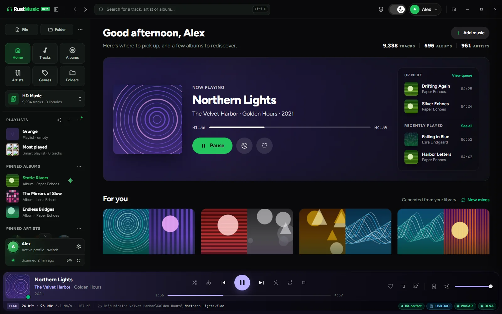
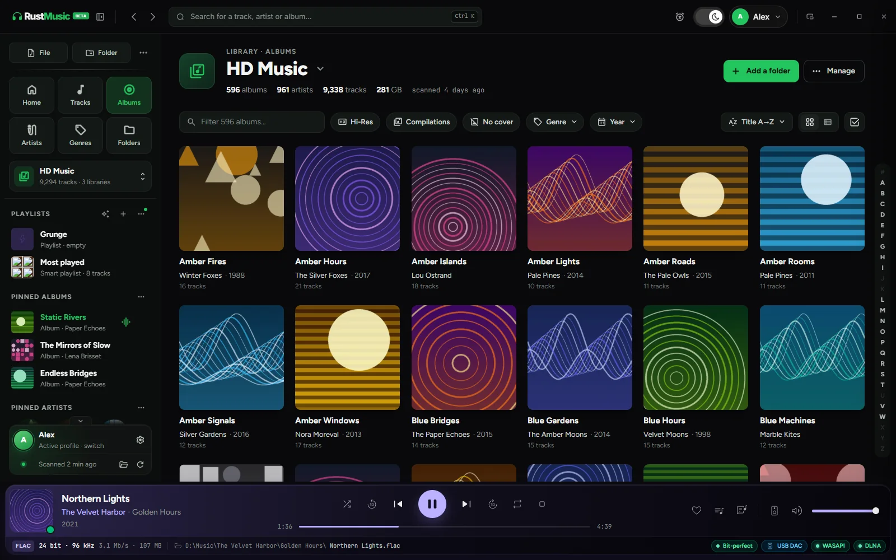
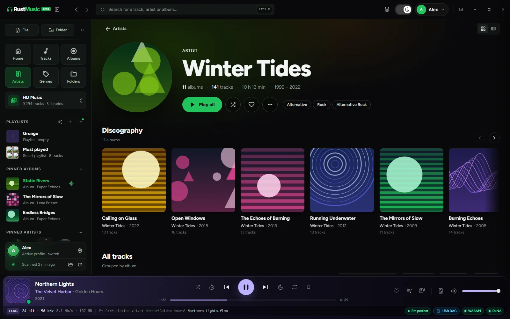
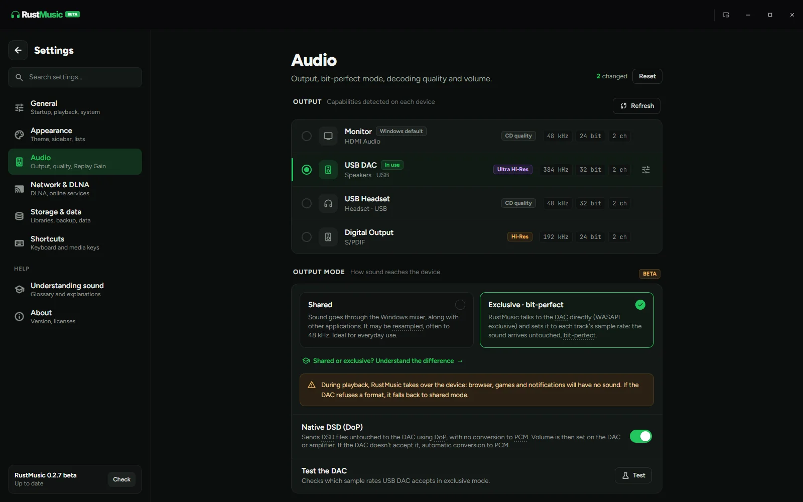
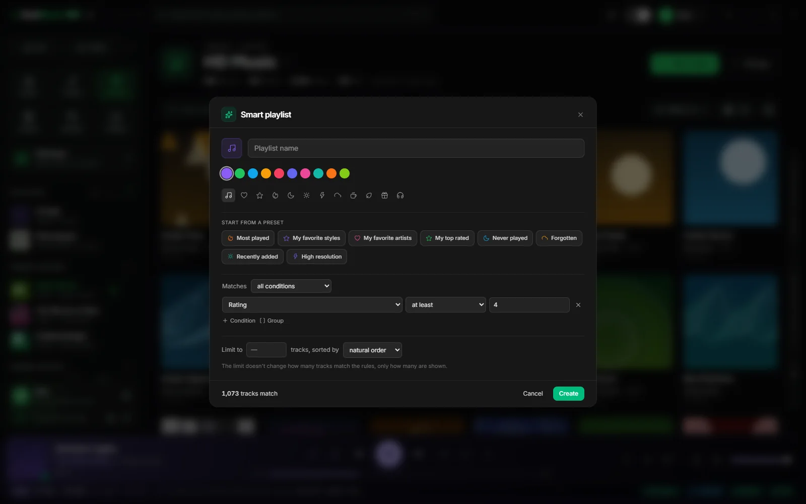

<div align="center">

# RustMusic

**Free, open-source Hi-Res music player for Windows, macOS and Linux.**
Bit-perfect playback, native DSD, a beautiful library, no account, no ads, no tracking.

[](https://rustmusic.dev/downloads)
[](LICENSE)
[](https://rustmusic.dev/downloads)
[](https://rustmusic.dev)

[**Website**](https://rustmusic.dev) · [**Download**](https://rustmusic.dev/downloads) · [**Documentation**](https://rustmusic.dev/en/docs) · [**Guides**](https://rustmusic.dev/en/guides) · [**Changelog**](CHANGELOG.md)

🇫🇷 [Lire en français](README.fr.md)



</div>

---

## Why RustMusic

- **Bit-perfect output.** Exclusive mode sends your files to the DAC untouched, at their original sample rate: WASAPI exclusive on Windows, direct ALSA on Linux, CoreAudio hog mode on macOS.
- **Native DSD.** DSF and DFF files go to your DAC over DoP, which decodes them natively, with no conversion to PCM.
- **The same app on all three systems.** One interface, one library, the same audio settings on Windows, macOS (Apple Silicon and Intel) and Linux.
- **A library you enjoy browsing.** Album and artist pages, daily mixes, smart playlists, tag editing, synced lyrics.
- **Respects you.** Free, GPL-3.0, no account, no ads, no telemetry. It plays your files, that's it.

## Features

### Audio
- Formats: **FLAC, ALAC, WAV, AIFF, MP3, AAC / M4A, OGG Vorbis, Opus, DSF, DFF**
- **Exclusive · bit-perfect** output mode, with automatic fallback to shared mode if the DAC rejects a format
- **Native DSD over DoP** (DSD64, DSD128, DSD256 depending on your DAC); DSD to PCM conversion when DoP isn't supported
- Multichannel SACD decoding, with correct ITU-R BS.775 downmix to stereo
- High-precision resampling ([rubato](https://github.com/HEnquist/rubato)) when the output can't take the file's rate
- Decoding quality profiles: Auto, Maximum, Balanced, Compatibility, Degraded (for modest machines and VMs)
- Gapless playback, ReplayGain (track or album, with pre-amp), playback resume
- Audio chain shown in the player: format, bit depth, sample rate, bit-perfect / native DSD / output badges

### Library
- Several libraries per profile, local folders, external drives and NAS (network paths are pre-loaded to avoid dropouts)
- Fast incremental scan: thousands of files in seconds, only new or changed files on rescan
- Albums, Artists, Genres, Years, Folders and Tracks views, with filters, sorting and A–Z navigation
- Album pages (best quality, discs, label, similar albums) and artist pages (portrait, discography, "Appears on")
- Instant search (Ctrl K), liked tracks, recently played, pinned albums and artists
- Multiple profiles, each with its own libraries, playlists and favorites

### Tags, covers and lyrics
- Tag editing for MP3, FLAC, DSF and DFF: single track, batch, or the spreadsheet-style **tag workshop**
- Metadata and cover lookup through the public Deezer API (no account needed)
- Covers from embedded art, `cover.jpg` / `folder.jpg`, Deezer or a file you pick
- Synced lyrics from a `.lrc` file next to the track or from [LRCLIB](https://lrclib.net)

### Playlists
- Regular playlists, and **smart playlists** that build themselves from rules: 24 fields plus any tag in your files, nested AND/OR groups, limit and sorting, with the matching track count updated live
- 8 ready-made presets: top rated, forgotten, high resolution, most played, never played, recently added, favorite artists, favorite styles

### Network and system
- Built-in **DLNA / UPnP media server**: play your library on a network amplifier, a TV or a connected speaker, files sent untouched
- System media controls (Windows SMTC, macOS Now Playing, Linux MPRIS) and keyboard media keys
- Mini player with queue and synced lyrics, sleep timer, listening statistics
- Dark, light and high-contrast themes, configurable window buttons
- Interface in **English, French, Spanish, German and Italian**
- Signed in-app updates

## Screenshots

| | |
|:---:|:---:|
|  |  |
| Albums view | Artist page |
|  |  |
| Audio settings: exclusive mode and native DSD | Smart playlist editor |

<sub>Screenshots use a fictional demo library.</sub>

## Download

Get the latest version from **[rustmusic.dev/downloads](https://rustmusic.dev/downloads)** or the [GitHub releases](https://github.com/larevuegeek/rustmusic-desktop/releases).

| System | Package |
|---|---|
| Windows 10 / 11 (64-bit) | `.exe` installer |
| macOS 10.15+ (Apple Silicon and Intel) | Universal `.dmg` |
| Linux (64-bit) | `.deb` (Debian, Ubuntu, Mint), `.rpm` (Fedora, openSUSE), `.AppImage` |

A glibc 2.35 compatibility build is available for older distributions (Ubuntu 22.04, Debian 12).

> The installers aren't signed with a commercial certificate, so Windows SmartScreen and macOS Gatekeeper show a warning on first launch. The [installation guide](https://rustmusic.dev/en/docs/installation) explains how to open the app. In-app updates are cryptographically signed and verified.

## Build from source

### Requirements

- [Rust](https://rustup.rs) (stable)
- [CMake](https://cmake.org) (used to build libopus for Opus playback)
- [karbon-ui](https://github.com/larevuegeek/karbon-ui), the native UI toolkit, checked out next to this repository (`../karbon-ui`)

**Linux (Debian / Ubuntu)**

```bash
sudo apt install -y \
  build-essential curl git pkg-config cmake libssl-dev \
  libasound2-dev libpulse-dev libdbus-1-dev
```

**macOS**

```bash
xcode-select --install
brew install cmake
```

**Windows**

Install the [Microsoft C++ Build Tools](https://visualstudio.microsoft.com/visual-cpp-build-tools/) ("Desktop development with C++" workload) and [CMake](https://cmake.org/download/).

### Build

```bash
git clone https://github.com/larevuegeek/karbon-ui.git
git clone https://github.com/larevuegeek/rustmusic-desktop.git
cd rustmusic-desktop
cargo build --release
```

The binary is written to `target/release/`.

### Development

```bash
cargo run
```

## Architecture

```
rustmusic-desktop/
├── src/
│   ├── core/              # Audio engine (player, decoders, resampler, DSD, DLNA)
│   ├── commands/          # Engine operations called by the interface
│   ├── repository/        # SQLite layer (sqlx)
│   ├── mapper/            # Entity ↔ DTO mapping
│   ├── app/               # Application handle, managed state, events
│   ├── ui/                # Native interface (karbon-ui templates, styles, translations)
│   ├── lib.rs             # Engine start-up, then the window
│   └── main.rs
├── SQL/                   # Versioned migrations
├── icons/                 # Application icons
├── packaging/             # Flatpak, winget, macOS
├── Cargo.toml
└── CHANGELOG.md
```

**Stack:** Rust · karbon-ui (native UI: Direct2D, Metal, Vulkan; templates with Tailwind 4 classes) · tokio, axum · CPAL, Symphonia, rubato, in-house DSD decoder · SQLite through sqlx with versioned migrations · souvlaki for system media controls.

## Contributing

Contributions are welcome. Read [CONTRIBUTING.md](CONTRIBUTING.md) for code style, commit conventions and the pull request process. To report a bug or suggest a feature, [open an issue](https://github.com/larevuegeek/rustmusic-desktop/issues); for security issues, see [SECURITY.md](SECURITY.md).

If RustMusic is useful to you, a ⭐ on the repository helps other people find it.

## Code signing policy

Free code signing provided by [SignPath.io](https://about.signpath.io), certificate by [SignPath Foundation](https://signpath.org). Who signs what, and how: [code signing policy](CODE_SIGNING.md). What RustMusic sends over the network, and how to turn it off: [privacy policy](PRIVACY.md).

## License

RustMusic is released under the [GNU General Public License v3.0](LICENSE).
